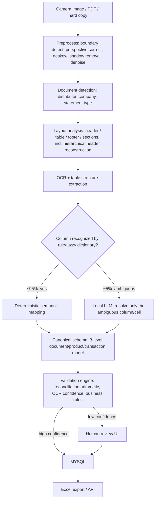

# Pharma Stock & Sale Statement Intelligence — Project Instructions

## Scope and purpose

These instructions apply to the entire project: architecture decisions, code, prompts, schemas, and documentation.

This project builds a **Document Intelligence pipeline** that converts heterogeneous, often photographed, distributor Stock & Sale statements into one standardized, validated pharma dataset — without sending documents or extracted data to external AI/OCR APIs, and without building a bespoke parser per distributor format.

Treat this as a document-understanding problem, not an OCR problem. OCR only produces text; the hard part is inferring table structure, column semantics, and row-level business meaning from arbitrary layouts, then mapping that meaning onto a fixed canonical schema.

Non-negotiable constraints, in priority order:

1. **Privacy** — no document, extracted text, or derived data ever leaves the private/on-prem environment. No calls to hosted OCR or LLM APIs (OpenAI, Groq, Claude API, Textract, Document AI, etc.) for anything touching real distributor data. Local models only (self-hosted via Ollama/vLLM/TGI, or on-box OCR).
2. **Cost** — MVP infra is lightweight and mostly open-source. No GPU cluster, no managed document-AI service, no per-page paid OCR, and no LLM call on every document when a deterministic rule already resolves it (see "Cost-effective extraction hierarchy" below).
3. **Heterogeneity** — one pipeline must generalize across distributor formats via schema mapping and rule/LLM-assisted field understanding, not per-distributor if/else parsers. A new distributor format should require config/mapping-dictionary changes, not new code paths.

## Problem framing (source of truth)

> Given any distributor's Stock & Sale statement, can we automatically understand what each field and row represents and reliably transform it into our standardized pharma data model?

Reject any design that reduces to "run OCR and regex the output." Every extraction step must be justified by *how it generalizes to an unseen layout*, not by how well it fits the sample documents on hand.

## Observed real-world formats (ground truth for design decisions)

Six real distributor statements have been reviewed and must inform every schema/pipeline decision below — do not design against hypothetical layouts when real ones are on file:

| Distributor | Company covered | Granularity | Format quirks |
|---|---|---|---|
| Nabin Drug Centre | Eris Lifescience | Company-level totals (one row, values only, PTR/PTS split within one cell) | No quantities at all on this page — value-only summary |
| Nabin Drug Centre (page 2) | Eris Lifescience | Per-product | Has `HSN Code` per row — a real product-master join key, not just a name |
| Mediland | Zorvia Healthcare | Per-product | Has `Rate` (unit price) and `M.Exp` (months-to-expiry) columns |
| B.N. Drug Distributor | Zorvia Healthcare | Per-product + a separate embedded **Purchase Detail block** (Invoice No/Date/Receive Date/Amount/Supplier) on the same page | Non-stock data mixed into the same document |
| Medico Drug Agency | Zorvia Healthcare | Per-product | Same shape as Mediland — confirms this layout is a shared distributor-software template, not distributor-specific, good evidence the mapping-not-parsing approach will generalize |
| New Tripura Pharmaco | Zorvia Healthcare | Per-product | Splits returns into `Market Return` / `Return Outward` / `Short Quantity` (finer-grained than other formats) and adds a `Stock Status` field (`UNSOLD`, or days-since-last-movement, e.g. `113Days`) |

Also important, visible directly in the samples: these are **camera photographs of hard-copy or dot-matrix printouts**, not clean scans — expect page curvature, perspective distortion, shadows, fold creases, uneven illumination, low contrast, skew, and moiré/printing patterns. Preprocessing is not optional and can matter more than which OCR engine is chosen.

Consequences for the design:

- Column semantics for "return" and "receipt" are **not uniformly granular** across distributors — some formats collapse categories others split out. Mapping must support several source columns onto one canonical field (many-to-one), not assume 1:1 correspondence.
- A document can be **company-level-only with no line items** (Nabin page 1). The pipeline must detect this and emit a document-level summary rather than forcing an empty product table through row extraction. This is a first-class case, not an error state — see the 3-level data model below.
- A page can contain **more than one region type** (B.N. Drug Distributor's Purchase Detail block). Layout analysis must segment a page into multiple typed regions, not assume one table per page.
- Column headers can be **hierarchical** — e.g. `OPENING` spans two sub-columns `QTY` and `VALUE`, and the same pattern repeats for `RECEIPT`, `ISSUE`, `CLOSING`. Flat OCR text output loses this nesting (`OPENING QTY VALUE RECEIPT QTY VALUE...`); the structure/layout stage must reconstruct the parent–child header relationship before semantic mapping runs, or mapping will silently misalign columns.

## Data model: 3 levels, not one flat table

Because documents range from company-level summaries to per-product statements with hierarchical headers, the internal data model is relational, not a single flat table:

**Level 1 — Document**: `document_id`, `distributor_name`, `company_name`, `statement_from`, `statement_to`, `document_type` (`summary` | `product_level`), `source_file`, `page_number`, `page_count`.

**Level 2 — Product** (absent for summary-only documents): `product_id`, `product_name_raw`, `hsn_code`, `pack`, `rate`.

**Level 3 — Transaction/stock** (one per product per period, or one per document for summary-only cases): `opening_qty`, `opening_value`, `received_qty`, `received_value`, `free_received_qty`, `sales_qty`, `free_sales_qty`, `sales_value`, `sales_return_qty`, `purchase_return_qty`, `expired_qty`, `closing_qty`, `closing_value`, `stock_status` (e.g. `UNSOLD`, days-since-movement), `months_to_expiry`.

The **canonical Stock & Sale schema** used for validation, review, and flat export is a join view across these three levels, plus pipeline metadata:

| Field | Notes |
|---|---|
| `distributor_id` / `distributor_name` | Resolved against a distributor master, not free text |
| `company_name` | The pharma company whose products the statement covers |
| `period` (`statement_from`/`statement_to`) | Normalized to a standard date range |
| `document_type` | `summary` \| `product_level` — drives whether Level 2/3 product rows are expected |
| `product_id` | Resolved against product master catalogue (HSN code first, then fuzzy + code match) |
| `product_name_raw` | Original string as it appeared on the source document |
| `hsn_code` | Primary product-resolution key when present (e.g. Nabin) |
| `pack` | e.g. "10's", "1x60ML" — disambiguates SKUs with the same name but different pack |
| `rate` | Unit price, when the source states it; null otherwise, not zero |
| `opening_quantity` / `opening_value` | Qty / currency |
| `received_quantity` / `received_value` | Qty / currency |
| `free_received_quantity` | Qty |
| `sales_quantity` / `sales_value` | Qty / currency |
| `free_sales_quantity` | Qty |
| `sales_return_quantity` | Qty — if a source splits this further (New Tripura: Market Return / Return Outward / Short Quantity), sum into this field and preserve the split in `source_field_breakdown` |
| `purchase_return_quantity` | Qty |
| `expired_quantity` | Qty |
| `closing_quantity` / `closing_value` | Qty / currency |
| `months_to_expiry` | When present (Mediland's `M.Exp`) |
| `stock_status` | When present (New Tripura's `UNSOLD` / days-since-movement); null when the source doesn't report it |
| `source_field_breakdown` | JSON/text of any source columns combined into a canonical field, so granularity is never silently lost |
| `source_document` / `page_number` | Traceability back to the original file and page |
| `extraction_confidence` | Per-field confidence score, not just per-row |
| `review_status` | `auto_accepted` \| `needs_review` \| `human_corrected` |

You will not populate every field for every document — a summary-only statement legitimately has null Level 2/3 product fields. That's a correct output, not a failure.

A row that fails validation is never dropped silently — it is flagged `needs_review` with a reason, not discarded.

## Pipeline architecture

Stage responsibilities:

1. **Ingest & preprocess (OpenCV)** — document boundary detection, perspective correction, deskew, shadow removal, grayscale, adaptive thresholding, noise removal. Because the real inputs are camera photographs of folded/creased paper (not clean scans), this stage is not optional and can affect output quality more than the choice of OCR engine.
2. **Document detection** — identify distributor, company, and statement type from header text, so downstream stages can apply any distributor-specific mapping hints already learned.
3. **Layout analysis (PP-StructureV3)** — detect header, table, footer, and other page regions, and reconstruct hierarchical headers (e.g. `OPENING` → `QTY`/`VALUE` sub-columns) before flattening to text. A page is not guaranteed to be a single table — segment mixed pages (e.g. B.N. Drug Distributor's embedded Purchase Detail block) into multiple typed regions, and route non-stock regions separately rather than forcing them into the Stock & Sale grid.
4. **OCR (PaddleOCR)** — extract text, bounding boxes, and per-token confidence within the regions/cells that layout analysis produced.
5. **Cost-effective extraction hierarchy for semantic mapping** — don't send every document to an LLM:
   - **Deterministic normalization first**: a maintained mapping dictionary plus fuzzy string matching resolves the large majority of columns (e.g. `OPENING`, `OPENING QTY`, `OPENING STOCK`, `OP STOCK`, `OPEN QTY` → `opening_quantity`; `RECPT QTY`, `RECEIVED`, `PURCHASE QTY` → `received_quantity`). This is pure Python, no model call, and should resolve the great majority of columns across the formats already on file.
   - **Local LLM fallback only for genuinely ambiguous columns/cells** the dictionary doesn't recognize (e.g. an abbreviation like `OUTW`). Scope the LLM call to the ambiguous column/cell, not the whole document — this keeps LLM cost proportional to novelty, not document volume.
   - Every new distributor format should extend the mapping dictionary (and add new confirmed mappings back into it after human review), not add a new code path.
6. **Canonical schema assembly** — write into the 3-level document/product/transaction model above, with a Pydantic (or equivalent) model enforcing types and required fields before anything downstream trusts it.
7. **Product master resolution** — match against the product master catalogue using `hsn_code` first when present, then exact product code, then fuzzy/embedding match on `product_name_raw` + `pack` as the fallback. Unmatched products go to review, not to a guessed ID.
8. **Validation engine** — deterministic checks, not LLM-based: `opening + received + free_received - sales - free_sales - sales_return + purchase_return - expired = closing` (adapted to the distributor's actual reconciliation formula), sign checks, plausibility ranges, and cross-checks against per-field OCR confidence. A mismatch (e.g. opening 68, receipt 0, sales 49, but closing reported as 87) is a stronger, cheaper signal than OCR confidence alone — treat it as first-class validation output, not a debug log line.
9. **Human review UI** — surface the original document crop next to the extracted row, with a per-field confidence bar (product name, opening, sales, closing, etc. scored separately), and Approve/Correct actions. Every correction is retained — it becomes future mapping-dictionary entries and, longer-term, evaluation data for the pipeline itself.
10. **Output** — MYSQL as the system of record, matching the canonical schema; Excel export and an API endpoint as consumption surfaces. Every row carries full traceability to `source_document`/`page_number`.

## Technology defaults

Prefer stack choices consistent with existing infra unless there's a specific reason to diverge — this keeps the MVP cheap to operate and easy to hand off:

- **Backend / API**: FastAPI. React for the human-review/approval UI. Isolate OCR/layout/LLM calls in workers rather than forcing them into the request/response cycle — those are blocking/CPU- or GPU-bound.
- **Preprocessing**: OpenCV for boundary detection, perspective correction, deskew, shadow removal, adaptive thresholding, denoising.
- **OCR + layout/table structure**: PaddleOCR for text/bounding boxes/confidence, PP-StructureV3 for layout detection, table detection, table structure, and cell/header reconstruction. This is the committed choice for the MVP given the real sample quality (camera photos, not clean scans) — re-benchmark only if PP-Structure demonstrably fails on a new format, not by default.
- **Semantic mapping**: a maintained rule/mapping dictionary + fuzzy matching (Python) as the primary path; a locally-hosted small LLM (Ollama/vLLM) only as a fallback for columns the dictionary can't resolve. Do not route every document through the LLM — see the extraction hierarchy above.
- **Orchestration of the multi-stage pipeline**: LangGraph, mirroring the existing Geneilytics orchestrator pattern — each pipeline stage above is a node, with explicit state passed between nodes (not implicit globals).
- **Validation**: Pydantic models at every stage boundary (OCR output → structuring → mapping → canonical schema), same discipline as `orchestrator.py`.
- **Storage**: MYSQL for the canonical 3-level dataset and product/distributor masters; Redis for pipeline job/queue state; a vector store (Qdrant) only if fuzzy product matching is done via embeddings rather than string similarity.
- **LLM**: locally hosted only (Ollama/vLLM) — do **not** default to Groq or any hosted provider for this project, even though other projects use Groq. This is the one place the usual stack must change, because of the privacy constraint.

## MVP success criteria (do not gold-plate beyond this)

The MVP is done when, across the distributor formats already on file (Nabin Drug Centre, Mediland, B.N. Drug Distributor, Medico Drug Agency, New Tripura Pharmaco), the pipeline:

1. Preprocesses camera-photo-quality inputs (perspective distortion, folds, shadows, skew) well enough for OCR to run reliably.
2. Extracts and structures their tables automatically, including reconstructing hierarchical headers, with no per-distributor parser code.
3. Maps their differing column names/layouts into the canonical schema via the deterministic-first/LLM-fallback hierarchy, including many-to-one return/receipt splits and distributor-specific extras (`hsn_code`, `rate`, `months_to_expiry`, `stock_status`) where present.
4. Correctly represents a company-summary-only document (no product rows) using the 3-level data model, without erroring or fabricating rows.
5. Segments a multi-region page (e.g. stock table + purchase detail block) instead of merging unrelated data into one table.
6. Resolves products against the master catalogue, preferring `hsn_code` where available.
7. Validates extracted quantities with the reconciliation rule and flags failures, using field-level confidence in the review queue.
8. Produces a usable Excel/DB output, with uncertain rows routed to a human review UI instead of silently wrong data, and captures corrections for future mapping-dictionary improvement.

Do not build: multi-tenant SaaS features, a full annotation/training pipeline, distributor onboarding automation, or fine-tuned custom models. Those are post-MVP.

## Working conventions

- When adding support for a new distributor format, the default fix is a mapping-dictionary entry, a fuzzy-match alias, or a master-catalogue alias — not a new code branch. If a new code branch seems necessary, say so explicitly and explain why the mapping approach failed.
- Only escalate a column to the local LLM when the deterministic dictionary and fuzzy matching genuinely can't resolve it. Every LLM-resolved mapping that gets confirmed should be added back to the dictionary so it's resolved deterministically next time.
- Never propose sending real (even anonymized-looking) distributor data to a hosted API "just for prototyping." Use synthetic or genuinely de-identified samples for any experiment that must leave the local environment.
- Every extracted row must be traceable to its source document and page. If a design can't produce that trace, flag it before implementing.
- State assumptions about a distributor's document format explicitly when writing extraction logic or mapping rules — don't silently generalize from one sample layout.
- Confidence scores (per field, not just per row) and validation failures are first-class data, not debug output — they drive the review queue.
- Human corrections in the review UI are retained data, not throwaway UI state — they feed back into the mapping dictionary and, later, evaluation.

## Completion checklist

- [ ] No stage calls a hosted OCR/LLM API with real document data.
- [ ] Adding a new distributor format required only a mapping-dictionary/config change, no new parsing code path.
- [ ] The majority of columns are resolved deterministically; the local LLM is invoked only for genuinely ambiguous columns, not routinely.
- [ ] Every field in the canonical schema is populated or explicitly null with a reason (including summary-only documents).
- [ ] Every row carries `source_document`, `page_number`, and per-field `extraction_confidence`.
- [ ] Validation reconciliation check runs on every row before it's marked `auto_accepted`.
- [ ] Unmatched products route to review rather than being guessed.
- [ ] Output matches the canonical schema exactly (no ad hoc renamed columns).
- [ ] A many-to-one return/receipt split from the source is summed correctly into the canonical field and preserved in `source_field_breakdown`, not dropped.
- [ ] A company-summary-only document is represented via the 3-level model (`document_type: summary`, null product/transaction fields), not forced into empty product rows.
- [ ] A multi-region page routes non-stock regions (e.g. purchase detail blocks) separately instead of merging them into the Stock & Sale table.
- [ ] Hierarchical headers (e.g. `OPENING` → `QTY`/`VALUE`) are reconstructed before semantic mapping runs, not flattened and guessed at.
- [ ] `hsn_code` is used ahead of fuzzy name matching for product resolution whenever the source provides it.
- [ ] Human review corrections are captured and feed back into the mapping dictionary.
